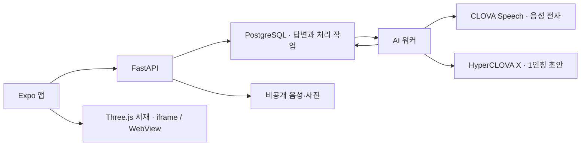

# 담소 · Damso

**부모와 자녀가 하루 한 질문에서 시작해 서로의 이야기를 쌓는 비동기 가족 소통 앱**

## 프로젝트 소개

통화 시간을 맞추기 어려운 부모와 자녀가 각자 편한 시간에 질문에 답하고, 가족의 이야기를 개인 서재처럼 둘러볼 수 있도록 만들었습니다. 글이나 녹음으로 답하면 AI가 제목과 1인칭 이야기 초안을 제안합니다. 작성자가 내용을 확인해 공개하면 연결된 가족이 2D 서재에서 읽을 수 있습니다.

## 주요 기능

| 사용자 흐름 | 구현 |
| --- | --- |
| 질문 받기 | 가족 초대 코드로 부모와 자녀를 연결합니다. 기본·개별·AI 꼬리질문·가족 예약을 합해 사용자별 하루 최대 3개를 서버에서 관리합니다. |
| 이야기 남기기 | 글 입력 또는 녹음으로 답하고, 전사·요약 상태 확인부터 재답변·건너뛰기·최종 공개까지 진행합니다. |
| 가족 기록 보기 | 날짜·작성자별 이야기 탐색, 사진 첨부·가족 앨범, 공유된 원문 확인·원음 재생을 제공합니다. |
| 3D 서재 둘러보기 | 웹과 모바일에서 같은 Three.js 장면을 열고, 책과 액자를 선택해 이야기 목록과 가족 앨범으로 이동합니다. |

## 아키텍처



| 영역 | 기술과 코드 위치 |
| --- | --- |
| 앱 | Expo, React Native, Expo Router, TypeScript · [damso-mobile](damso-mobile/) |
| 3D 서재 | Three.js, React Three Fiber, Vite · [damso-library](damso-library/) |
| 서버 | FastAPI, SQLAlchemy, Alembic, PostgreSQL · [damso-server/backend](damso-server/backend/) |

## 핵심 구현

1. **수정 전 AI 결과가 새 답변을 덮어쓰지 않도록 처리합니다.** 워커는 PostgreSQL에서 작업을 확보하고 외부 API를 트랜잭션 밖에서 호출합니다. 저장 직전에 답변 리비전과 처리 시도를 다시 확인합니다. 음성은 전사와 요약을 별도 작업으로 처리합니다. [작업 처리 코드](damso-server/backend/app/processing.py)
2. **공개 시점과 공유 범위를 작성자가 결정합니다.** AI 초안은 작성자만 확인할 수 있습니다. 제출 직후 가족이 공개 본문을 읽을 수 있고, 원문과 원음은 별도로 공유하거나 해제할 수 있습니다. [답변 API](damso-server/backend/app/api/routes/answers.py) · [서재 API](damso-server/backend/app/api/routes/library.py)
3. **3D 장면을 웹과 앱에서 재사용합니다.** Expo 웹의 iframe과 모바일 WebView가 같은 장면을 로드합니다. 준비·오류·이동 이벤트를 전달하고, 책과 액자 이벤트는 정해진 앱 화면으로만 연결됩니다. [3D 화면](damso-mobile/src/app/library-3d.tsx) · [3D 이벤트](damso-library/src/EmbedBoundary.tsx)

## 실행 및 검증

**화면 미리보기**는 계정이나 AI 키 없이 열 수 있습니다. Windows에서 Git과 Node.js/npm을 준비합니다.

```powershell
git clone https://github.com/Hyunhoim/Damso.git
cd Damso
npm ci --prefix damso-library
npm ci --prefix damso-mobile
powershell -ExecutionPolicy Bypass -File scripts/start-damso-preview.ps1
```

[Expo 웹](http://localhost:8081)에서 질문 화면과 서재를 둘러볼 수 있습니다. [3D 서재](http://localhost:5174)도 함께 실행됩니다.

**실제 가족 기록과 AI 처리**를 확인하려면 새 터미널에서 저장소 루트 기준으로 실행합니다. Python 3.14와 uv가 필요합니다.

```powershell
cd damso-server/backend
uv sync --python 3.14
.venv/Scripts/python.exe -X utf8 scripts/run-local.py
```

실행 도우미가 로컬 PostgreSQL, 마이그레이션, API와 워커를 시작합니다. [로컬 키 설정](http://127.0.0.1:8000/dev/llm)에서 STT·LLM 키를 등록한 뒤 [API 계약](damso-server/backend/API_CONTRACT.md)에 따라 계정 생성과 가족 연결을 완료하고 앱 설정에서 로그인합니다.

```powershell
npm test --prefix damso-mobile
npm run typecheck --prefix damso-mobile
npm run build --prefix damso-library
```

## 구현 범위

회원가입과 초대 코드 연결은 API에서 지원하며, 앱 설정은 연결을 마친 계정의 로그인을 지원합니다. 3D 액자 표면은 예시 이미지이고 실제 가족 사진은 연결된 앱의 앨범에서 엽니다. 댓글·공감·앱 내부 알림은 API에서 제공됩니다.

[앱 개발 문서](damso-mobile/README.md) · [3D 서재 문서](damso-library/README.md) · [백엔드 실행 가이드](damso-server/backend/RUNBOOK.md) · [백엔드 템플릿 출처](damso-server/backend/UPSTREAM.md)
