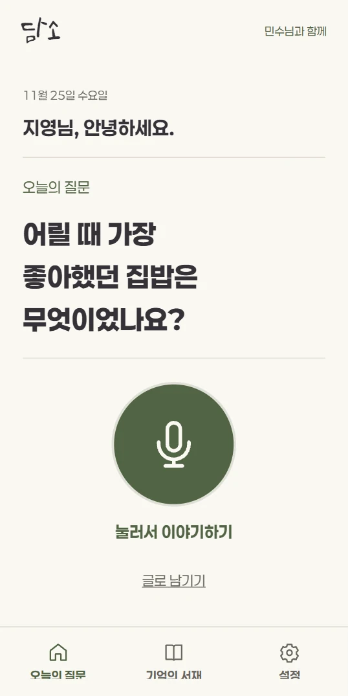
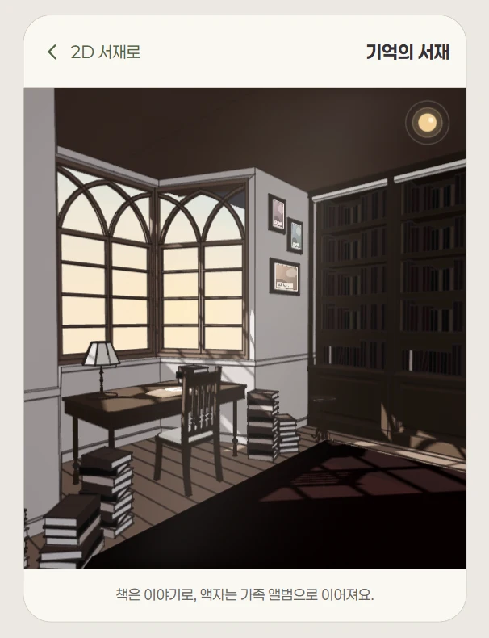

<h1> 담소 · Damso</h1>

## Overview

담소는 부모와 자녀가 **각자 편한 시간에 답을 남기고 서로의 이야기를 읽는 가족 소통 앱**입니다. 질문 한 개로 대화를 시작하고, 글이나 음성으로 남긴 답변을 가족의 서재에 모을 수 있습니다.

## Features & Demo

### 오늘의 질문과 음성 답변

기본 질문에 글이나 음성으로 답합니다. 서버에 연결하면 녹음을 CLOVA Speech로 전사하고 HyperCLOVA X가 제목과 1인칭 요약 초안을 제안합니다. 작성자가 초안을 확인해 제출하면 가족이 읽을 수 있습니다.

<p></p>

*로컬 Expo 웹 미리보기의 질문 화면. 화면에는 예시 질문과 가족 정보가 표시됩니다.*

### 기억의 서재와 가족 앨범

공개한 이야기를 날짜와 작성자별로 찾아보고, 공유된 원문·원음을 확인할 수 있습니다. 3D 서재에서 책과 액자를 선택하면 이야기 목록과 가족 앨범으로 이동합니다.

<p></p>

*로컬 Expo 웹에서 실제 렌더링한 3D 서재. 액자에는 예시 이미지가 표시됩니다.*

## Tech Stack

| 영역 | 기술 |
| --- | --- |
| 앱 | Expo, React Native, Expo Router, TypeScript |
| 3D | Three.js, React Three Fiber, Vite |
| 서버·데이터 | FastAPI, SQLAlchemy, Alembic, PostgreSQL |
| 음성·요약 | CLOVA Speech, HyperCLOVA X HCX-007 |

## How to Run

Windows에서 Git과 Node.js를 준비합니다. 화면 미리보기는 계정과 AI 키 없이 열 수 있습니다.

```powershell
git clone https://github.com/Hyunhoim/Damso.git
cd Damso
npm ci --prefix damso-library
npm ci --prefix damso-mobile
powershell -ExecutionPolicy Bypass -File scripts/start-damso-preview.ps1
```

[앱 미리보기](http://localhost:8081)와 [3D 서재](http://localhost:5174)가 열립니다.

녹음 전사·요약과 가족 계정 연결까지 확인하려면 Python 3.14와 uv를 준비하고 별도 터미널에서 다음을 실행합니다.

```powershell
cd damso-server/backend
uv sync --python 3.14
.venv/Scripts/python.exe -X utf8 scripts/run-local.py
```

[로컬 키 설정](http://127.0.0.1:8000/dev/llm)에서 STT·LLM 키를 등록합니다. [API 계약](damso-server/backend/API_CONTRACT.md)에 따라 가족 계정을 연결한 뒤 앱 설정에서 로그인합니다.

## Appendix

- **비동기 처리** · 전사와 요약을 별도 작업으로 실행합니다. 워커가 저장 전 답변 리비전을 다시 확인해, 수정 전 결과가 최신 답변을 덮어쓰는 상황을 막습니다. [작업 처리 코드](damso-server/backend/app/processing.py)
- **공개 권한** · 작성자가 공개한 본문은 연결된 가족이 읽을 수 있습니다. 원문과 원음은 각각 공유하거나 해제할 수 있습니다. [답변 API](damso-server/backend/app/api/routes/answers.py)
- **개발 검증** · 저장소 루트에서 `npm test --prefix damso-mobile`로 9개 단위 테스트를 실행할 수 있습니다. [모바일 개발 기록](damso-mobile/README.md) · [백엔드 실행 가이드](damso-server/backend/RUNBOOK.md)
